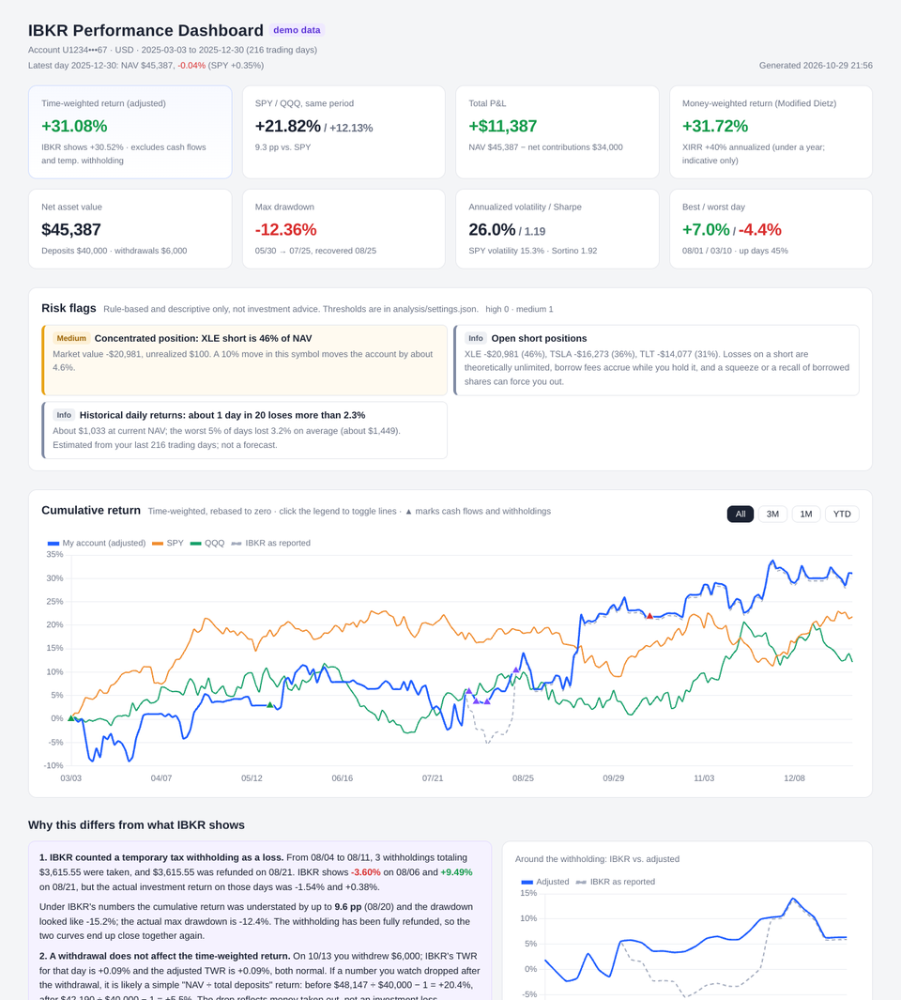

# IBKR Flex Performance

Pull your Interactive Brokers account data automatically every day and turn it into an **offline HTML performance dashboard**: a correctly adjusted time-weighted return, money-weighted return, SPY/QQQ comparison, drawdowns, positions and long/short exposure, per-symbol P&L, trading-style changes and rule-based risk flags.

Everything runs on your own computer through IBKR's official, read-only Flex Web Service. No trading permissions, no TWS or IB Gateway, and no data leaves your machine.



## Why

IBKR's built-in return figures can be misleading in two common situations:

- **Temporary tax withholding.** IBKR sometimes withholds tax up front (recorded as `transactionTax` in Flex) and refunds it days later. IBKR's TWR treats the withholding as an investment loss and the refund as a gain, so the curve plunges and then jumps back, and the drawdown looks far worse than it was. This project treats such withholdings as cash temporarily leaving and returning to the account, so they don't count as investment P&L.
- **Withdrawals.** A time-weighted return is not affected by withdrawals, but simple measures such as "NAV ÷ total deposits" drop sharply after you take money out. The dashboard shows both side by side and explains where the difference comes from.

IBKR's charts also lack a benchmark comparison and any analysis of the trading itself. This project adds both.

## Features

- **Return chart**: adjusted TWR, IBKR as reported, SPY and QQQ on one chart, with All / 3M / 1M / YTD views and markers for deposits, withdrawals and withholdings
- **Reconciliation**: finds temporary withholdings and withdrawals automatically and compares IBKR's daily return with the adjusted one, day by day. If your account never had a temporary withholding, the IBKR comparison lines and the withholding explanation are hidden automatically, since the two measures are then essentially the same
- **Money-weighted return**: Modified Dietz and XIRR, plus "what if the same deposits and withdrawals had gone into SPY"
- **Risk metrics**: max drawdown, annualized volatility, Sharpe, Sortino, beta and correlation to SPY, and tail risk estimated from the account's own daily returns
- **Positions**: open positions, long/short value, and daily long/short exposure with gross leverage
- **P&L by symbol**: realized, unrealized and net dividends per symbol (options grouped under their underlying)
- **Trade analysis**: win rate, payoff ratio, profit factor, long vs. short P&L, FIFO holding periods, intraday share, turnover, largest winning and losing closes
- **Trading-style changes**: month-by-month execution frequency, holding period, short share, payoff ratio, exposure and concentration, with notable changes in the latest month highlighted
- **Risk flags**: concentrated positions, high leverage, open shorts and rising borrow fees, losing positions held unusually long, outsized single losses, more trading after big losing days, drawdowns, stale data, expiring token, and more (all thresholds configurable)
- **Fees and income**: dividends, interest, withholding tax, commissions, margin interest, borrow fees
- **Monthly snapshots**: a copy of the dashboard is kept for every month

All flags are descriptive. Nothing here is investment advice.

## Quick preview (no IBKR account needed)

```bash
pip install -r requirements.txt
python demo/generate_demo.py
python analysis/build_dashboard.py demo --demo
```

Then open `demo/ibkr_dashboard.html`. On Windows you can also double-click `demo/run_demo.bat`. The demo account is entirely fictitious and randomly generated.

The demo includes a temporary withholding to show the reconciliation. To see how the dashboard looks for a typical account without one, run `python demo/generate_demo.py --no-withholding` (add `--no-withdrawal` to drop the withdrawal too) before building.

## Using your own account

### Requirements

- Windows 10/11 for the data pull (PowerShell and Task Scheduler are built in)
- Python 3.9+ with `pip install -r requirements.txt` (only pandas and numpy)
- The dashboard builder itself is cross-platform; you can copy `data/` to macOS or Linux and build there

### Setup

1. **Create the Flex Query and token.** Follow [docs/FLEX_SETUP.md](docs/FLEX_SETUP.md) and note your Query ID and token.
2. **First pull.** Double-click `run_pull.bat` and enter the Query ID and token when prompted. The token is encrypted with Windows DPAPI and stored in `config/`; only your Windows user on this computer can decrypt it. A successful run logs something like `Success: 20251029 ~ 20261028 | days=261, ...`.
3. **Build the dashboard.** If Python is installed, `ibkr_dashboard.html` is rebuilt automatically after every pull. You can also double-click `build_dashboard.bat` at any time.
4. **Daily updates.** Double-click `setup_schedule.bat` to register a scheduled task (Tuesday to Saturday at 07:00; if the computer is off, it runs at the next opportunity). Failures show a Windows notification. To remove the task: `setup_schedule.bat -Remove`.
5. Optional: set `token_expiry` in `analysis/settings.json` to your token's expiry date, and adjust the risk-free rate or risk thresholds.

When the token expires or you generate a new one, double-click `reset_token.bat` and enter it again.

## Project layout

```
run_pull.bat / pull_ibkr.ps1        pull the Flex report and SPY/QQQ prices, then rebuild the dashboard
reset_token.bat                     enter a new Query ID / token
setup_schedule.bat / install_schedule.ps1   add or remove the daily scheduled task
build_dashboard.bat                 rebuild the dashboard manually
analysis/
  engine.py                         merge data; TWR, money-weighted return, benchmarks, positions, P&L, trade stats
  risk.py                           monthly trading style, risk flags, rolling metrics
  build_dashboard.py                render the HTML and print a text summary
  template.html                     dashboard template (Chart.js is downloaded to analysis/vendor/ on first run and inlined)
  settings.json                     risk-free rate, token expiry, risk thresholds
demo/                               demo data generator
docs/FLEX_SETUP.md                  IBKR Flex Query setup guide
claude-skill/SKILL.md               optional skill template for using this with Claude

Created at runtime (excluded by .gitignore, never committed):
config/                             encrypted token
data/raw/, data/history/, data/latest.xml   Flex reports
data/benchmarks/                    SPY / QQQ prices
data/pull_log.txt                   pull log
ibkr_dashboard.html, reports/       dashboard and monthly snapshots
```

## Methodology

- **Adjusted TWR**: daily return = (ending NAV − starting NAV − external cash flow) ÷ (starting NAV + that day's inflow), with inflows at the start of the day and outflows at the end, chained across days. External cash flows are deposits, withdrawals, asset transfers and temporary tax withholdings (`transactionTax`).
- **IBKR as reported**: the daily `twr` field from the Flex report, chained, shown for comparison. Without temporary withholdings the two should be essentially identical (they match exactly on the demo data).
- **Money-weighted return**: Modified Dietz = total P&L ÷ time-weighted average invested capital. XIRR is the annualized internal rate of return and is inflated for periods shorter than a year.
- **Benchmarks**: SPY and QQQ dividend-adjusted closes, rebased to the account's start date.
- **Risk metrics**: computed only on days after the account exceeded $5,000; risk-free rate 4% by default. Rolling 63-day metrics appear once there are 252 trading days of data.
- **P&L by symbol**: FIFO realized + current unrealized + net dividends (after withholding tax).

## Risk flag rules

All thresholds are in `analysis/settings.json` under `thresholds`:

| Rule | Default threshold |
|---|---|
| Single position as % of NAV | ≥40% medium, ≥60% high |
| Gross exposure / NAV | ≥1.5× medium, ≥2× high |
| Monthly borrow fees jump | ≥3× the earlier monthly average and ≥ $50 |
| Losing position held for | ≥3× your average holding period (at least 7 days) |
| Single loss in the last 31 days | ≥2% of NAV at the time, or ≥5× your average win |
| Latest month's payoff ratio | < 1 |
| Current drawdown | ≥5% medium, ≥10% high |
| Executions the day after a loss of ≥3% | ≥1.5× normal |
| Stale data | more than 3 business days old |
| Token expiry | ≤30 days left |
| Notable trading-style change | relative change ≥50%, or share change ≥20 percentage points |

## Privacy and security

- Uses only IBKR's official read-only Flex Web Service: **it cannot place orders**, and TWS / IB Gateway are not needed.
- The token stays on your computer, encrypted with Windows DPAPI, and never appears in logs or in the dashboard.
- Account data, dashboards and snapshots stay local. `.gitignore` excludes `data/`, `config/`, `reports/` and the generated HTML. **If you fork this project, double-check before committing that none of these are included.**
- The account number is masked in the dashboard.

## Using it with Claude (optional)

If you use Claude (Cowork), replace the paths in `claude-skill/SKILL.md` with your own folder and save it as a skill. Then say "update" and Claude checks whether the data is current, rebuilds the dashboard and summarizes what changed and any new risk flags; say "review this month" for a monthly recap.

## Limitations

- The data pull script is Windows-only.
- Benchmark prices come from Yahoo Finance's unofficial endpoint and are meant for personal use. If it changes or a download fails, the dashboard simply omits the benchmarks; account data is unaffected.
- Mainly tested on individual accounts trading stocks, ETFs and some options. Multi-currency accounts, futures and bonds have not been tested thoroughly.
- With less than a year of history, annualized figures such as annualized return and Sharpe are unstable and indicative only.

## Disclaimer

This project is for personal portfolio review only and is not investment, tax or legal advice. Results may differ from IBKR's official statements; IBKR's statements are authoritative.

## License

[MIT](LICENSE). The dashboard uses [Chart.js](https://www.chartjs.org/) (MIT License), downloaded on first run.
