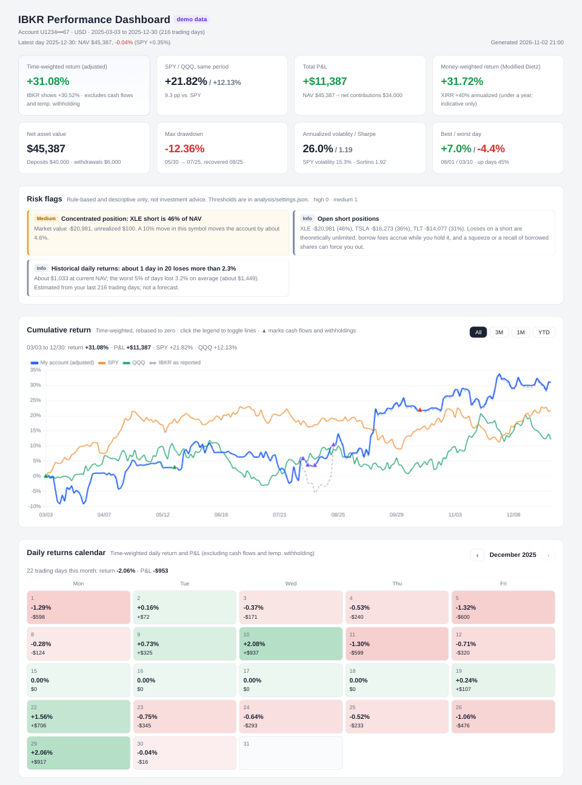

# IBKR Flex Performance

[English](README.md) | **简体中文**

每天自动拉取盈透证券（Interactive Brokers）账户数据，生成一个**离线 HTML 收益分析仪表盘**：正确调整后的时间加权收益、资金加权收益、SPY/QQQ 对比、回撤、持仓与多空敞口、个股盈亏、交易风格变化，以及按规则生成的风险提示。

全部在你自己的电脑上运行，只用 IBKR 官方的只读 Flex Web Service。不需要交易权限，不需要 TWS 或 IB Gateway，数据不会离开你的电脑。

**[在线示例（中文）→](https://wesleywang28.github.io/ibkr-flex-performance/zh/)** · [英文版示例](https://wesleywang28.github.io/ibkr-flex-performance/)（虚构的随机账户）



## 为什么做这个

IBKR 自带的收益率在两种常见情况下会误导人：

- **临时预扣税。** IBKR 有时会先预扣一笔税（Flex 里记为 `transactionTax`），几天后再退回。IBKR 的 TWR 把预扣当成投资亏损、把退回当成收益，所以曲线会先骤降再跳回，回撤看起来比实际严重得多。本项目会把每笔退回和之前的预扣配对，当作资金暂时流出、再流回账户，不计入投资盈亏。始终没有退回的交易税（印花税、金融交易税）仍作为真实成本计入盈亏。
- **提现。** 时间加权收益不受提现影响，但"净值 ÷ 累计入金"这类简单算法在取钱之后会明显下降。仪表盘把两种口径放在一起，并解释差异从哪里来。

IBKR 的图表也没有基准对比，更没有对交易本身的分析。本项目把这两样都补上了。

## 功能

- **收益曲线**：调整后 TWR、IBKR 原始口径、SPY、QQQ 画在同一张图上，可切换 全部 / 近3个月 / 近1个月 / 今年以来，并标出入金、提现和预扣。图上方和鼠标提示里会在收益率旁边显示所选区间的盈亏金额
- **每日收益日历**：按月显示每个交易日的收益率和盈亏，附当月合计，可以往前翻看之前的月份
- **对账说明**：自动找出临时预扣和提现，逐日对比 IBKR 的日收益和调整后的日收益。如果账户从来没有临时预扣，IBKR 对比线和预扣说明会自动隐藏，因为这时两种口径基本一致
- **资金加权收益**：Modified Dietz 和 XIRR，以及"同样的出入金如果都买 SPY 会怎样"
- **风险指标**：最大回撤、年化波动、夏普、Sortino、对 SPY 的 β 和相关性，以及基于账户自身日收益的尾部风险
- **持仓**：当前持仓，附当日盈亏和持有天数；资产构成横条（个股 / ETF / 期权 占净值的比例，多空分开）；每日多空敞口和总杠杆
- **摊薄成本**：和 A 股券商的“摊薄成本价”一样。做 T 时，把这一轮的已实现盈亏（和分红）摊进成本，做 T 成功后多头的成本会下降（空头的摊薄卖出价会上升），而不是只记成当天盈利。和 IBKR 的成本价并排显示，多头空头都支持
- **个股盈亏**：每个标的的已实现、未实现和分红净额（期权归入对应正股）
- **交易分析**：胜率、盈亏比、盈利因子、多头 vs 空头盈亏、FIFO 持仓时间、日内占比、换手、最大盈利和最大亏损的平仓
- **交易风格变化**：逐月的成交频率、持仓时间、空头占比、盈亏比、敞口和集中度，最新月份变化明显的指标会高亮
- **风险提示**：持仓集中、杠杆偏高、持有空头和融券费上升、亏损单持有过久、单笔大额亏损、大亏后交易变多、回撤、数据未更新、Token 快过期等（阈值都可以调整）
- **费用与收入**：分红、利息、预扣税、佣金、融资利息、融券费
- **月度快照**：每个月保留一份仪表盘
- **中文或英文**：在 `analysis/settings.json` 里把 `"language"` 设为 `"zh"` 或 `"en"`（也可以用 `--lang zh`）；手机上也能正常查看

所有提示都只描述数据，不构成投资建议。

## 快速预览（不需要 IBKR 账户）

```bash
pip install -r requirements.txt
python demo/generate_demo.py
python analysis/build_dashboard.py demo --demo --lang zh
```

然后打开 `demo/ibkr_dashboard.html`。Windows 上也可以双击 `demo/run_demo.bat`（按 `settings.json` 里的语言生成）。示例账户完全是虚构、随机生成的。运行测试：`python -m unittest discover -s tests`。

示例数据里包含一次临时预扣，用来演示对账说明。想看没有预扣的普通账户是什么样子，先运行 `python demo/generate_demo.py --no-withholding`（再加 `--no-withdrawal` 可以去掉提现），然后重新生成。

## 用于自己的账户

### 环境要求

- 拉取数据需要 Windows 10/11（PowerShell 和任务计划程序都是系统自带的）
- Python 3.9+，运行 `pip install -r requirements.txt`（只需要 pandas 和 numpy）
- 生成仪表盘的部分是跨平台的，可以把 `data/` 拷到 macOS 或 Linux 上生成

### 设置步骤

1. **创建 Flex Query 和 Token。** 按 [docs/FLEX_SETUP.zh-CN.md](docs/FLEX_SETUP.zh-CN.md) 操作，记下 Query ID 和 Token。
2. **第一次拉取。** 双击 `run_pull.bat`，按提示输入 Query ID 和 Token。Token 用 Windows DPAPI 加密后存在 `config/`，只有这台电脑上你的 Windows 用户能解密。成功时日志里会有类似 `Success: 20251029 ~ 20261028 | days=261, ...` 的记录。
3. **生成仪表盘。** 如果装了 Python，每次拉取后会自动重新生成 `ibkr_dashboard.html`。也可以随时双击 `build_dashboard.bat`。想要中文界面，先把 `analysis/settings.json` 里的 `"language"` 改成 `"zh"`。
4. **每天自动更新。** 双击 `setup_schedule.bat`，会注册一个每天本地时间 07:00 运行的任务计划（电脑关机时会在下次开机后补跑）。IBKR 在美东时间夜间发布前一天的数据，所以在美国以外请选晚一点的时间，比如亚洲用 `setup_schedule.bat -At 19:30`，欧洲用 `-At 14:00`。失败时会弹出 Windows 通知。删除任务：`setup_schedule.bat -Remove`。
5. 可选：在 `analysis/settings.json` 里设置 `language`（`"zh"` 或 `"en"`）、把 `token_expiry` 设为 Token 的到期日，以及调整无风险利率、交易税处理方式和风险阈值。

Token 过期或重新生成后，双击 `reset_token.bat` 重新输入即可。

拉取脚本和日志 `data/pull_log.txt` 统一用英文（风险提示会按日志里的 `ERROR:` / `Success:` 判断拉取是否失败），不影响仪表盘的语言。

## 项目结构

```
run_pull.bat / pull_ibkr.ps1        拉取 Flex 报表和 SPY/QQQ 行情，然后重新生成仪表盘
reset_token.bat                     重新输入 Query ID / Token
setup_schedule.bat / install_schedule.ps1   添加或删除每日任务计划
build_dashboard.bat                 手动重新生成仪表盘
analysis/
  engine.py                         合并数据；TWR、资金加权收益、基准、持仓、盈亏、交易统计
  risk.py                           月度交易风格、风险提示、滚动指标
  build_dashboard.py                生成 HTML 并输出文字简报
  template.html                     仪表盘模板（中英文文字都在这里；Chart.js 首次运行时下载到 analysis/vendor/ 并内嵌）
  settings.json                     语言、无风险利率、交易税处理方式、Token 到期日、风险阈值
demo/                               示例数据生成器
docs/FLEX_SETUP.zh-CN.md            IBKR Flex Query 设置指南（英文版：docs/FLEX_SETUP.md）
.github/workflows/pages.yml         自动生成中英文在线示例并发布到 GitHub Pages
claude-skill/SKILL.md               可选：配合 Claude 使用的 skill 模板
tests/                              用人造用例和示例账户做的自动测试

运行时生成（已在 .gitignore 中排除，不会提交）：
config/                             加密的 Token
data/raw/, data/history/, data/latest.xml   Flex 报表
data/benchmarks/                    SPY / QQQ 行情
data/pull_log.txt                   拉取日志
ibkr_dashboard.html, reports/       仪表盘和月度快照
```

## 计算方法

- **调整后 TWR**：每日收益 = (期末净值 − 期初净值 − 外部现金流) ÷ (期初净值 + 当日流入)，流入算在当天开始、流出算在当天结束，逐日连乘。外部现金流包括入金、提现、资产转入转出和临时预扣税。
- **每日盈亏与日历**：当日盈亏 = 期末净值 − 期初净值 − 外部现金流，和调整后 TWR 口径一致。每日数字按官方收盘价计价，所以盘后成交价和收盘价相差很大时，当天会出现一笔账面盈亏、第二天回吐；跨天累计不受影响。
- **交易税**（Flex 里的 `transactionTax`），由 `analysis/settings.json` 里的 `"transaction_tax"` 控制：`"auto"`（默认）按先进先出把每笔退回和之前的预扣配对，配上的部分当作临时现金流，没有退回的部分作为成本计入盈亏；`"temporary"` 把所有金额都当作临时现金流；`"cost"` 把所有金额都当作成本。
- **IBKR 原始口径**：直接连乘 Flex 报表里每天的 `twr` 字段，用于对比。没有临时预扣时两者应该基本一致（在示例数据上完全一致）。
- **初始本金**：如果数据第一天之前账户里已经有钱（账户比拉取的数据更早，且没有补历史数据），第一天的净值算作初始本金，用于累计盈亏和资金加权收益。
- **资金加权收益**：Modified Dietz = 累计盈亏 ÷ 按时间加权的平均投入资本。XIRR 是年化内部收益率，不足一年时数值会被放大。
- **基准**：SPY 和 QQQ 使用含分红的调整收盘价，起点和账户对齐。
- **风险指标**：只用账户资金超过 $5,000 以后的交易日计算；无风险利率默认 4%。数据满 252 个交易日后显示滚动 63 日指标。
- **个股盈亏**：FIFO 已实现 + 当前未实现 + 分红净额（扣除预扣税）。
- **摊薄成本**（股票和 ETF）：每个标的从仓位为 0 开始到再次回到 0 算一轮，清仓后重新开始。多头 = (本轮买入总额 − 卖出总额 + 佣金 − 分红净额) ÷ 当前股数；空头 = (本轮卖出总额 − 买回总额 − 佣金 − 支付的分红) ÷ 当前空头股数，即摊薄后的卖出价。一笔成交直接从多翻空（或反过来）时按数量拆开。分红按除权日归属。摊薄盈亏 = 未实现盈亏 + 本轮已实现 + 本轮分红，总能和 IBKR 的数字对上；只改变显示方式，不影响累计盈亏和收益率。数据第一天之前就已持有的仓位，从那天 IBKR 的成本价算起（标“*”）。期权仍用 IBKR 的成本。
- **币种**：全部按账户基础货币显示；其他币种的交易和持仓用 IBKR 的 `fxRateToBase` 换算。

## 风险提示规则

所有阈值都在 `analysis/settings.json` 的 `thresholds` 里：

| 规则 | 默认阈值 |
|---|---|
| 单一持仓占净值 | ≥40% 中，≥60% 高 |
| 总敞口 / 净值 | ≥1.5× 中，≥2× 高 |
| 当月融券费跳升 | ≥ 此前月均的 3 倍且 ≥ $50 |
| 亏损持仓持有时间 | ≥ 你平均持仓时间的 3 倍（至少 7 天） |
| 最近 31 天的单笔亏损 | ≥ 当时净值的 2%，或 ≥ 平均盈利的 5 倍 |
| 最新月份盈亏比 | < 1 |
| 当前回撤 | ≥5% 中，≥10% 高 |
| 单日亏损 ≥3% 后次日成交笔数 | ≥ 平时的 1.5 倍 |
| 交易税未退回 | 任何金额（按成本显示） |
| 数据未更新 | 超过 3 个工作日 |
| Token 到期 | 剩余 ≤30 天 |
| 交易风格明显变化 | 相对变化 ≥50%，或占比变化 ≥20 个百分点 |

## 隐私与安全

- 只使用 IBKR 官方只读的 Flex Web Service：**无法下单**，也不需要 TWS / IB Gateway。
- Token 只保存在你的电脑上，用 Windows DPAPI 加密，不会出现在日志或仪表盘里。
- 账户数据、仪表盘和快照都留在本地。`.gitignore` 排除了 `data/`、`config/`、`reports/` 和生成的 HTML。**如果你 fork 了这个项目，提交前请再确认这些文件都没有被加进去。**
- 仪表盘里的账号会打码显示。

## 配合 Claude 使用（可选）

如果你用 Claude（Cowork），把 `claude-skill/SKILL.md` 里的路径换成你自己的文件夹，再保存为 skill。之后说"更新"，Claude 会检查数据是否最新、重新生成仪表盘，并总结变化和新的风险提示；说"复盘本月"会得到月度回顾。

## 局限

- 拉取数据的脚本只支持 Windows。
- 基准行情来自 Yahoo Finance 的非官方接口，仅供个人使用。如果接口变化或下载失败，仪表盘只是不显示基准，账户数据不受影响。
- 主要在交易股票、ETF 和少量期权的个人账户上测试过。多币种账户会换算成基础货币，但实际测试较少；期货和债券没有测试过。
- 数据不足一年时，年化收益、夏普等年化指标波动较大，仅供参考。

## 免责声明

本项目仅用于个人投资复盘，不构成投资、税务或法律建议。结果可能和 IBKR 官方结单有出入，以 IBKR 结单为准。

## 许可证

[MIT](LICENSE)。仪表盘使用 [Chart.js](https://www.chartjs.org/)（MIT 许可证），首次运行时下载。
